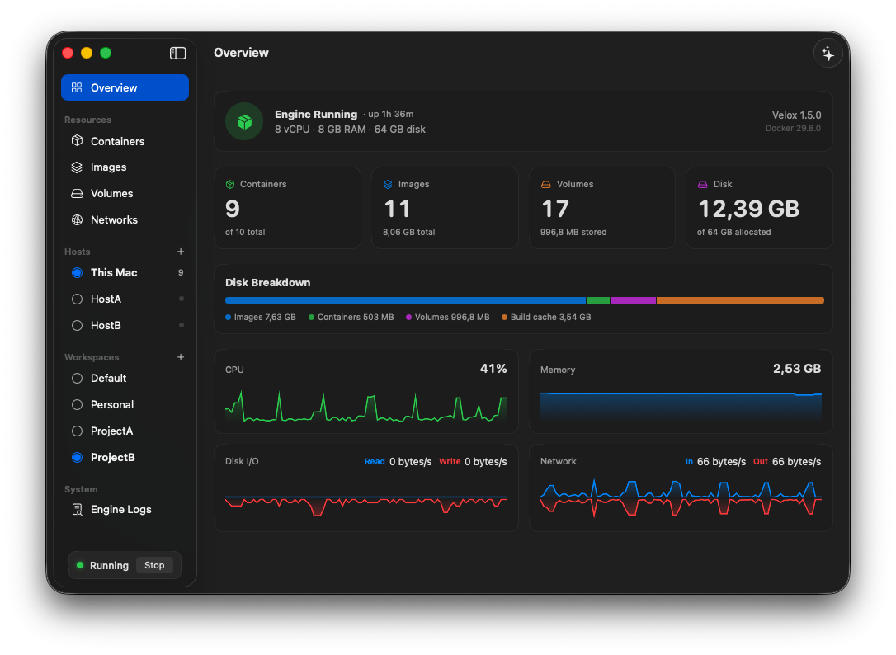
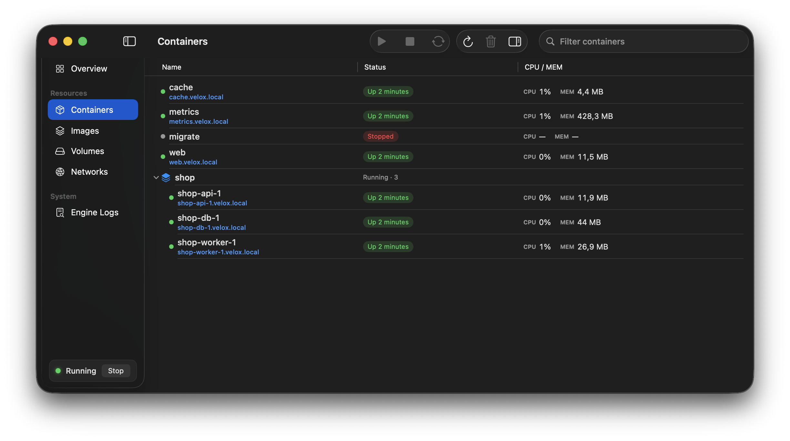

<div align="center">

# Velox

**A fast, lean, open-source way to run Docker on Apple-silicon Macs.**

100% Swift host · stock Docker Engine · custom kernel.org kernel · no Electron, no Go, no background daemons

[](https://github.com/mikaelhug/Velox/releases)


[](LICENSE)

[Website](https://mikaelhug.github.io/Velox/) ·
[Benchmarks](docs/benchmarks.md) ·
[Releases](https://github.com/mikaelhug/Velox/releases) ·
[Discord](https://discord.gg/kNysBA9VU5)



</div>

Velox runs a real Docker Engine in a minimal Linux VM on Apple's
`Virtualization.framework` — and gets out of the way: a self-contained app that
installs in 327 MB, restarts to a ready Docker API in 0.59 seconds, and drops to
133 MB of host memory once its resource saver stops the idle engine. Numbers below,
measured against Docker Desktop and OrbStack in one campaign, with the methodology,
the raw values and a runnable harness in
[docs/bench/REPORT-2026-10-11-3way.md](docs/bench/REPORT-2026-10-11-3way.md).

## Highlights

- **The stock `docker` CLI.** No wrapper command — Velox registers a Docker
  context named `velox`, so Testcontainers and every Docker SDK just work,
  alongside any other Docker install. **`compose` and `buildx` are bundled**: the
  app ships and links the two CLI plugins into `~/.docker/cli-plugins`, so
  `docker compose` / `docker buildx` work on a clean Mac with no Docker Desktop —
  and it never overwrites a compose/buildx you already have.
- **Reach containers by name** at `<name>.velox.local` — details below.
- **Switchable workspaces.** Park a whole project — containers, images, volumes,
  networks, build cache — and switch to a clean or cloned one in a couple of
  seconds, then switch back with everything as you left it. Duplicating a
  workspace is instant and takes no extra disk (APFS copy-on-write). Docker
  Desktop's only equivalent is its one-way "Clean / Purge data".
- **A native Mac app.** Compose-grouped containers, images, volumes and
  networks with live CPU/MEM, streaming logs, a ⌘K command palette, a menu-bar
  quick panel, crash notifications, and one-click Reclaim Space.
- **Nested virtualization** (M3+, opt-in): `/dev/kvm` inside containers — run
  QEMU, Firecracker or Android emulators *inside* Docker.
- **Multi-arch out of the box.** `linux/amd64` runs on **Rosetta**, `linux/arm`
  (v5/v6/v7) and `linux/386` on built-in QEMU — registered in the guest at boot, so
  there is no privileged `multiarch/qemu-user-static` step to re-run after every restart.
- **VirtioFS** bind mounts and the **containerd image store** (multi-platform
  images, attestations, Wasm).
- **Event-driven, never polling.** Published ports come up the instant a
  container starts; a Resource Saver balloons an idle engine down to a
  **sub-100 MB** host footprint (on macOS 27 it stops the idle engine and resumes it on the
  next `docker` command); the guest clock survives Mac sleep.
- **Self-updating** — `velox update` or the in-app Update button.

<div align="center">

</div>

## Install

Requires **macOS 15+ on Apple Silicon**. Guest kernel, rootfs, engine and the
`docker` client are all bundled.

```bash
curl -fsSL https://raw.githubusercontent.com/mikaelhug/Velox/main/install.sh | bash
```

Or manually: download the `.zip` from [Releases](https://github.com/mikaelhug/Velox/releases),
drag **Velox** to Applications, and clear Gatekeeper's download quarantine
(Velox is signed but not notarized):

```bash
xattr -dr com.apple.quarantine /Applications/Velox.app && open /Applications/Velox.app
```

First launch boots the engine, puts `docker` + `velox` on your `PATH`
(rootless symlinks), and registers the context:

```bash
docker context use velox
docker run --rm hello-world
```

The app boots the engine automatically on launch and keeps it running while
open; `velox start` runs the same engine headless (no GUI needed).

## Reach containers by name

Every container is reachable from the Mac at **`<name>.velox.local`** — its
*real* IP, any protocol, no `-p` required. Pure DNS + routing, no proxy in the
data path:

```bash
docker run -d --name web nginx
curl http://web.velox.local          # no published port needed

docker run -d --name db -e POSTGRES_HOST_AUTH_METHOD=trust postgres
psql -h db.velox.local -U postgres   # any protocol, not just HTTP
```

Compose services resolve as `<service>.<project>.velox.local`. This needs a
one-time admin grant on first launch (a tiny root helper installs a route and
an `/etc/resolver` entry — control-plane only, it never touches connection
data); decline it and everything else still works.

## Workspaces

Each project accumulates its own containers, images, volumes and networks. A
**workspace** keeps them apart: it is one complete, isolated engine state, and
exactly one is active at a time.

```bash
velox workspace ls                    # * marks the active one
velox workspace new client-a          # an empty workspace
velox workspace clone client-a demo   # instant, no extra disk until they diverge
velox workspace use client-a          # takes effect on the next start
velox workspace resize client-a 1024  # max disk size in GB (sparse: costs only what's used)
```

In the app, workspaces live in the sidebar: **+** creates one, clicking one
switches to it, and right-click offers Duplicate, Rename, Change Location and
Delete.

Switching restarts the engine (a couple of seconds) — the containers in the
workspace you leave keep their state and come back when you switch back. Only
container data is per-workspace; the Docker socket path never changes, so the
`docker` CLI, published ports and `<name>.velox.local` all follow the active
workspace with no reconfiguration.

Each workspace is a single sparse disk image, so an empty one costs nothing until
you use it. Images are not shared between workspaces — clone one if you want its
base images to start with. Deleting a workspace deletes its data permanently.

## Remote hosts

Docker Engines running on other machines — headless Linux servers, a NAS, a build
box — appear in the same window as the Mac's own engine. Add one with **+** beside
**Hosts** in the sidebar; click a host to point the Containers, Images, Volumes and
Networks panes at it. Everything works the same as it does locally: start and stop
containers, follow logs, inspect, pull, prune, live CPU and memory.

Velox connects over **SSH**, using your existing keys, `ssh-agent` and
`~/.ssh/config`. It never asks for a password and **stores no credentials** — a
host record is just a username, a hostname and a socket path. Under the hood it is
one `ssh -L` per connected host forwarding the server's `/var/run/docker.sock`;
nothing is installed or changed on the server.

Two things are needed on the server:

- SSH access with a key (`ssh you@server` already works from your Mac), and
- your user in the `docker` group, so it can reach the daemon socket.

If a host has never been connected to before, verify it once in Terminal
(`ssh you@server`) so its key lands in `known_hosts` — Velox will not accept an
unknown host key on your behalf.

Workspaces stay a *this Mac* feature: a workspace is Velox's own data disk, while a
remote host runs its own engine against its own storage. Removing a host from Velox
removes it from the sidebar and nothing else — its containers, images and volumes
are untouched.

## Published ports

`-p` follows Docker's own default: a published port binds **all interfaces**,
so it is reachable from other machines on your network — the same as Docker
Desktop, OrbStack and colima. Ports below 1024 work too (`-p 80:80`, `-p 22:22`).

```bash
docker run -d -p 8080:80 nginx              # reachable at <your-mac-ip>:8080
docker run -d -p 127.0.0.1:5432:5432 postgres   # host-only, stays private
```

An explicit **`127.0.0.1:`** in the `-p` spec always wins — a service you
deliberately pinned to loopback is never widened. To make host-only the
*default* for every port, set `publishHostIP` in `~/.velox/config.json`:

```json
{ "publishHostIP": "127.0.0.1" }
```

The value may also be a specific host address; an unparseable one falls back to
host-only rather than exposing anything. Changing it restarts the engine.

Two limits worth knowing: a **non-loopback host IP inside the `-p` spec**
(`-p 192.168.1.50:8080:80`) is unsupported — the guest daemon can't bind a
macOS address, so use `publishHostIP` instead; and a specific `publishHostIP`
can't be applied to ports below 1024, which fall back to host-only with a
warning.

## Performance

Measured on 2026-10-11 against Docker Desktop 4.94.0 and OrbStack 2.2.3 in **one campaign**:
the same Mac and the same night, one engine resident at a time, each at a verified 8 vCPU / 8 GB.
All three were emptied first and driven by the same `docker` CLI and compose plugin. Six rounds
ran the engines in all six orders, so each went first, middle and last twice. Medians, n=6
(n=3 for builds and compose, n=1 for the memory phases). Every raw value, the method and the
caveats are in [docs/bench/REPORT-2026-10-11-3way.md](docs/bench/REPORT-2026-10-11-3way.md).
`compose down` and disk reclaim (†) were re-measured the same morning, after Velox adopted a 3 s
stop default and the reclaim test was fixed.

| Metric | Velox | Docker Desktop | OrbStack |
| --- | --- | --- | --- |
| Install footprint | **327 MB** | 2,198 MB | 696 MB |
| Startup (quit → API-ready) | **0.59 s** | 1.79 s | 1.35 s |
| Idle RAM (host RSS, whole engine) | 667 MB | 2,306 MB | 767 MB |
| Idle RAM after the resource saver | **133 MB** | 989 MB | 753 MB |
| Idle CPU (idle state, after the 5-min saver timer¹) | **0.00 %** | 0.51 % | 0.15 % |
| RAM with 21 containers running | 1,543 MB | 3,098 MB | 1,563 MB |
| RAM 3 min after removing them | 1,566 MB | 3,052 MB | **1,149 MB** |
| Container launch (`run --rm alpine true`) | **0.09 s** | 0.13 s | 0.21 s |
| Network: container → container | **165 Gbit/s** | 92 Gbit/s | 91 Gbit/s |
| Published port, 1 stream | 47.9 Gbit/s | 12.5 Gbit/s | 49.3 Gbit/s |
| Published port, 4 streams | 20.2 Gbit/s | 25.7 Gbit/s | **30.3 Gbit/s** |
| `docker cp` out / in (1 GiB) | 715 / **932** MB/s | 220 / 148 MB/s | 694 / 546 MB/s |
| Small-file extract (4,000 files → bind mount) | 2.06 s | 2.35 s | **1.15 s** |
| Named-volume write | **2,303 MB/s** | 1,771 MB/s | 1,050 MB/s |
| Incremental `docker build` | 1.35 s | 1.48 s | 2.06 s |
| Postgres `pgbench` TPS (8 clients) | 15,750 | 14,693 | 6,550 |
| `compose down` (SIGTERM-ignoring services) † | 3.31 s | 3.50 s | 10.6 s |
| Disk still held 150 s after deleting ~5 GB † | 0 MB | 1,120 MB | 0 MB |

¹ Each product in its idle state: Velox and Docker Desktop after their 5-minute resource-saver
timeout, OrbStack — which has no saver — as it idles. In the first 4 minutes, with every VM still
running, it was 0.28 % / 1.51 % / 0.22 %.

Bold marks a clear winner: at least 15% ahead of both others, with spreads that don't
overlap. Rows without bold are par between the best two.

**Against Docker Desktop**, Velox is ahead nearly everywhere and trails once: published ports
with 4 streams. `compose down` used to be a second trail. For a container that ignores `SIGTERM`
it measures the stop grace period, not engine speed: Docker Desktop ships its dockerd with
`"default-stop-timeout": 3` instead of Docker's 10 s. Velox now ships the same 3 s default (3.31 s
vs 3.50 s; it was 10.3 s in the campaign). OrbStack keeps 10 s.

**Against OrbStack** it's a split decision. Velox is faster at:
- container launch, about 2.3×;
- startup;
- container networking;
- volume and overlay writes, about 2×;
- builds;
- Postgres, about 2.4×;
- `compose down` with SIGTERM-ignoring services (OrbStack keeps the 10 s grace period).

OrbStack is ahead on:
- small-file bind-mount I/O, 1.8×;
- published ports with 4 streams;
- giving memory back in the first minutes after a workload.

Velox returns memory by stopping the idle engine after 5 minutes, because macOS 27's memory
balloon frees nothing.

The 4-stream published-port number fell from a steady 60 Gbit/s on macOS 26.6 to 20–60 Gbit/s
on macOS 27. The cause is Apple's NAT, not Velox: the 1.7.0 build shows the same swing today, and
the Mac→VM direction of Apple's NAT measures ~14 Gbit/s with no Velox code in the path at all.
One stream is steady at 48 Gbit/s.

All three passed every functional probe: bind mounts, `host.docker.internal`, TCP/UDP/IPv6
publishing, per-container host IPs, privileged ports, BuildKit with attestations, and
`linux/amd64`, `linux/arm/v7` and `linux/386` emulation. Velox and OrbStack add direct
`<name>.local` container access. Docker Desktop also ships Kubernetes, Scout, Extensions and its
AI tooling, none of which Velox has; they account for much of its size.

The data disk is durable by default: a raw image attached with
`synchronizationMode: .fsync` and guest barriers on, so every committed write
survives a crash, a power-off and in-place updates. Freed space goes back to macOS by
`fstrim`, run a few seconds after Docker deletes something.

## How it's built

- **One Swift process** hosts everything: VM lifecycle, the Docker-API VSOCK
  proxy, port forwarding, DNS and the SwiftUI app. The only privileged piece
  is a tiny optional root helper for `<1024` ports and the named-access route.
- **Apple's in-kernel networking (VZNAT)** is the container datapath — no
  userspace network stack anywhere.
- **The kernel is built from kernel.org source**: `tinyconfig` plus a curated
  fragment, monolithic, tuned for fast container launch (`HZ_1000`, expedited
  RCU).
- **A tiny Rust `vinit` is PID 1**: one static musl binary does every boot
  step via direct syscalls — mounts, cgroups, clock, native DHCP, data disk,
  Rosetta — then supervises stock `dockerd` on a read-only, demand-paged
  **erofs** root. No LinuxKit, no initramfs, no dind.
- **Native-first**: prefer what dockerd and the kernel already provide (e.g.
  dockerd 29's nftables backend — the legacy iptables packages are simply not
  shipped); anything genuinely custom is focused Rust.

Every version is pinned in one file (`versions.env`); CI builds a release on
every `v*` tag.

## VPNs

Velox coexists with VPNs — including full-tunnel WireGuard — with one known
interaction: some VPN clients (notably the OpenVPN-based **AWS VPN Client**)
silently switch off macOS's kernel packet forwarding when they connect, which
kills NAT egress for **every** VM on the Mac (vmnet-based Docker engines, UTM,
Internet Sharing…), not just Velox. The symptom is DNS resolving but every
container connection timing out. Velox detects the flip the moment it happens
(event-driven, no polling) and restores forwarding through its privileged
helper, so container networking keeps working with the VPN connected. If the
helper grant was declined, the engine log names the cause and the one-line
manual fix (`sudo sysctl -w net.inet.ip.forwarding=1`).

## vs Apple's `container`

Apple's [`container`](https://github.com/apple/container) validates the same
architecture (kernel.org kernel, tiny init, Swift on Virtualization.framework)
but speaks no Docker API — compose and Docker tooling don't work — and its
VM-per-container model can't share named volumes and pays a VM boot per
container. Velox is a *Docker engine*: one shared VM, the real API, and it
runs on macOS 15, not just 26.

## Build from source

Needs Docker (guest builds run in `linux/arm64` containers) and Xcode 27 — the
Command Line Tools alone can't compile the app against the macOS 27 SDK. The build
scripts use Xcode's toolchain automatically and refuse an older one.

```bash
./Scripts/build-kernel.sh   # one-time: compile the kernel from source (long)
./Scripts/make-guest.sh     # build the erofs rootfs; install to ~/.velox
./Scripts/build.sh          # swift build -c release + ad-hoc codesign
./Scripts/build-app.sh      # package a self-contained Velox.app
./Scripts/run.sh start      # or: boot headless with a serial console
```

The signing entitlement is `com.apple.security.virtualization` only. Kernel
config lives in `guest/kernel/velox.fragment`; the guest filesystem in
`guest/rootfs/Dockerfile`.

## License

Velox is licensed under the GNU Lesser General Public License, version 2.1 or
later (`SPDX-License-Identifier: LGPL-2.1-or-later`). See [`LICENSE`](LICENSE)
for the full text.
